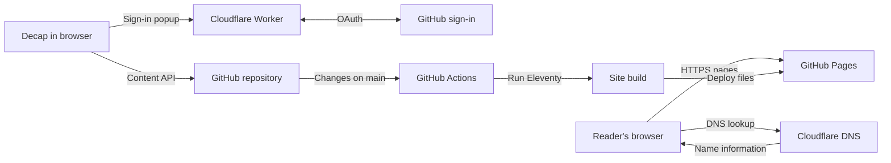
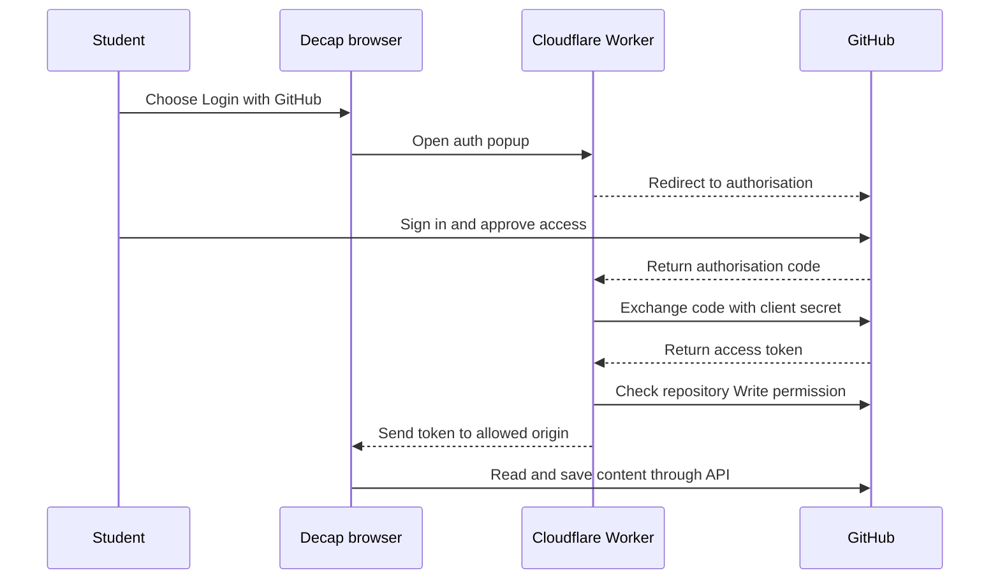

# Money Minute: new project member onboarding

Welcome! This guide is for students joining the project, including people who
have never used Git, GitHub, or a website editor. You do not need to be a
programmer to contribute. Technical words are introduced as you need them.

Our project has two goals: create useful, reviewed content and understand how
a real website is built, published, and maintained.

| Place | What you do there |
| --- | --- |
| [Public website](https://www.money-minute.com/) | Read the published project. No account is needed. |
| [Browser editor](https://www.money-minute.com/admin/) | Write posts and edit pages or selected design settings. |
| [GitHub repository](https://github.com/MonadicTrie/www.money-minute.com) | See the project's files, proposed changes, history, and automated checks. |

A **repository**, often shortened to **repo**, is a project's collection of
files and their recorded history. This README is its onboarding document. It is
displayed on GitHub; it is not automatically a page on the public website.

## Start here

### Your first-day checklist

1. Read the public site. Find Posts, About, Resources, and Contact. Some content
   and social handles are deliberately labelled as examples.
2. Ask the project lead or teacher what you should work on and who will review
   it. Start with one small, agreed change.
3. Create or use your approved GitHub account. Accept the repository invitation
   with **Write** access. Seeing a public repository does not give you editing
   permission.
4. Open the browser editor and choose **Login with GitHub**. Sign in on GitHub's
   own page and review the app's requested permissions.
5. Find **Posts**, **Pages**, and **Site settings**. Do not publish anything
   yet. Read [Your first contribution](#your-first-contribution) before saving
   your first draft.
6. Read the explanations below, then try the [self-test](#self-test). You should
   be able to explain the project in your own words, not just repeat tool names.

**Important:** this is a public repository. Saved drafts and uploaded files can
be visible in GitHub even when they are not on the website. Never use a draft
as private storage.

### Which role are you taking?

| Role | Normal responsibilities |
| --- | --- |
| Writer or page editor | Research, write, credit sources, and respond to review. |
| Reviewer | Check accuracy, readability, accessibility, permissions, and the passing build. |
| Maintainer | Look after templates, software updates, publishing, domain settings, and sign-in. |
| Repository administrator | Manage access and rules; handle account credentials and recovery. |

Most new members only need GitHub and the browser editor. You do **not** need a
Cloudflare account, DNS access, or server secrets to write a post. The
[maintainer reference](#maintainer-reference) is for people assigned those jobs.

### Reading map

- [The whole project](#the-whole-project)
- [Internet basics](#internet-basics)
- [DNS and our domain](#dns-and-our-domain)
- [From clicking a link to seeing a page](#from-clicking-a-link-to-seeing-a-page)
- [Git and GitHub](#git-and-github)
- [Files and the static site](#files-and-the-static-site)
- [What happens when we publish](#what-happens-when-we-publish)
- [Signing in with OAuth](#signing-in-with-oauth)
- [Your first contribution](#your-first-contribution)
- [Keeping the project safe](#keeping-the-project-safe)
- [Maintainer reference](#maintainer-reference)
- [Troubleshooting](#troubleshooting)
- [Glossary and further reading](#glossary-and-further-reading)
- [Self-test](#self-test)

## The whole project

The website, editor, file history, and sign-in service are different things.
Here is how they fit together:

| Tool or service | Its job in this project |
| --- | --- |
| Git | Records changes to project files. |
| GitHub | Hosts the repository and provides collaboration, account permissions, and review. |
| Decap CMS | The browser editor. CMS means **content management system**. It turns editor actions into changes in GitHub. |
| Eleventy | Builds finished web pages from our content, templates, and settings. |
| GitHub Actions | Runs automated tests, builds the site, and deploys it. |
| GitHub Pages | Hosts the finished public website files. |
| Cloudflare DNS | Publishes the domain's DNS information so devices can find the right service. |
| Cloudflare Worker | Runs our small sign-in service at `cms-auth.money-minute.com`. |



An **API**, or application programming interface, is a defined way for software
to request information or actions from other software. Decap uses GitHub's API
to read and save files instead of asking you to run Git commands yourself.

Notice what Cloudflare does **not** do: it does not host the public blog in this
setup. GitHub Pages does. Cloudflare hosts the separate sign-in program and
manages DNS.

## Internet basics

### The Internet is not the same as the Web

The **Internet** is a network of networks: connected devices that can exchange
data. Your school network, an Internet provider's network, and a hosting
company's network can communicate through it.

The **Web** is one service using the Internet. Browsers request web resources
using HTTP. Email, online games, and other applications also use the Internet,
but are not all the Web.

Your browser acts as a **client**: it requests something. A **server** responds.
These are roles, not necessarily special types of computer. A laptop can run a
development server; a hosting service can run many servers around the world.

### Devices, routers, and IP addresses

An **IP address** identifies a network location used to deliver data. IPv4
addresses look like `192.0.2.10`; IPv6 addresses look like `2001:db8::10`.
Those two addresses are documentation examples, not this site's servers.

Your device usually receives local network settings automatically through
**DHCP**. A **router** forwards traffic between networks. Your **ISP**, or
Internet service provider, connects your network to the wider Internet.

Many home IPv4 routers use **NAT**, network address translation, so several
devices can share one public IPv4 address. Do not assume every device has its
own public address, or that one address belongs to only one website. Hosting
services can serve many domain names from the same IP address.

### Packets, IP, and TCP

Data travels in small units called **packets**, rather than as one enormous
message. Packets carry addressing information. Routers forward them toward
their destination, sometimes over different routes.

**IP**, Internet Protocol, handles addressing and routing. It does not promise
that every packet arrives, arrives only once, or arrives in order.

**TCP**, Transmission Control Protocol, provides applications with a reliable,
ordered stream of bytes. It detects missing data, arranges retransmission, and
puts received data in order. It also helps control how quickly data is sent.
TCP does not itself encrypt the content.

A **port** identifies a service at a network address. The usual default ports
are **80 for HTTP** and **443 for HTTPS**. A domain, an IP address, and a port are
related, but they are not interchangeable.

### Protocols are agreed rules

A **protocol** is a set of rules for communication. A useful model for a
traditional HTTPS connection is:

| Layer | Question it answers |
| --- | --- |
| HTTP | What resource is requested, and what response is returned? |
| TLS | How is the connection protected and the server's identity checked? |
| TCP | How do the bytes arrive reliably and in order? |
| IP | Where should the packets go? |
| Wi-Fi, Ethernet, or mobile networking | How does data cross a local connection? |

This is a learning model, not a claim that every web connection uses TCP.
HTTP/1.1 and HTTP/2 commonly use TCP. **HTTP/3 uses QUIC over UDP instead**;
QUIC supplies reliability and encryption for that transport. You cannot tell
which HTTP version your browser negotiated just from seeing `https://`.

## DNS and our domain

### A name is easier to remember than an address

**DNS**, the Domain Name System, lets software look up information associated
with a domain name. Think of it as a distributed directory, not a website
delivery service.

In `www.money-minute.com`, `money-minute.com` is the registered domain and `www`
is a subdomain. Domain **registration** reserves the right to use the name.
DNS **hosting** manages its records. Those jobs can be done by different
companies; do not assume that using Cloudflare DNS means the domain was bought
from Cloudflare.

A **resolver** looks up DNS answers for your device. If it has no recent cached
answer, it can follow the DNS hierarchy to the domain's **authoritative
nameservers**, which publish the domain's records. Our authoritative DNS is
managed through Cloudflare.

### DNS record types

| Record | Meaning |
| --- | --- |
| A | Maps a name to an IPv4 address. |
| AAAA | Maps a name to an IPv6 address. |
| CNAME | Makes one name an alias of another name. |
| NS | Identifies authoritative nameservers. |
| TXT | Stores text, often used to prove control of a domain. |
| MX | Identifies mail servers; changing it can affect email. |

Our website uses this record:

```text
Type:    CNAME
Name:    www.money-minute.com
Target:  monadictrie.github.io
Proxy:   DNS-only (the grey cloud in Cloudflare)
```

The resolver follows the alias to find addresses. The target is a hostname,
not `monadictrie.github.io/www.money-minute.com/`: **DNS does not know URL paths
or which GitHub repository you want**.

GitHub Pages separately knows that `www.money-minute.com` belongs to this
repository because its custom-domain setting is configured there.

**A CNAME is not an HTTP redirect.** DNS lookup does not replace the address in
the browser's address bar. An HTTP redirect is a later server response telling
the browser to visit a different URL.

### Two hostnames, two jobs

| Hostname | Destination and purpose |
| --- | --- |
| `www.money-minute.com` | GitHub Pages, serving the public site and editor files. |
| `cms-auth.money-minute.com` | A Cloudflare Worker, running the OAuth callback service. |

The website CNAME is DNS-only: Cloudflare is **not** acting as an HTTP proxy for
that hostname. An HTTP proxy would receive and forward web requests. The auth
hostname, however, really does run on Cloudflare.

The original GitHub Pages address,
`https://monadictrie.github.io/www.money-minute.com/`, redirects to the configured
custom domain. This setup does not configure a redirect for the bare, or
**apex**, domain `money-minute.com`. Use the `www` address.

### Why DNS changes are not instant everywhere

DNS answers are cached for a **TTL**, or time to live. Your device and different
resolvers may retain different answers for a while, including an earlier
"name not found" answer. DNS information is not pushed instantly into every
computer.

When troubleshooting a recent DNS change, distinguish a bad record from a
correct record that a particular resolver has not refreshed yet. Do not keep
changing working records just because one browser is slow to catch up.

## From clicking a link to seeing a page

Consider `https://www.money-minute.com/about/`:

- `https` is the scheme: use secure HTTP.
- `www.money-minute.com` is the host name.
- `/about/` is the path: the resource requested from that host.
- Port 443 is implied because no port is written.

A URL can also contain a query such as `?view=example`. A fragment such as
`#section` is normally handled by the browser to identify a place within a
resource; it is not sent as part of the HTTP request to the server.

Here is a simplified journey for a first visit:

1. The browser works out the URL and checks whether it can reuse cached data or
   an existing connection.
2. A DNS lookup resolves the host name, following our CNAME to find addresses.
3. For a TCP-based connection, TCP establishes communication with the server.
4. **TLS**, Transport Layer Security, establishes a protected connection. The
   browser checks a **certificate** for the requested domain.
5. The browser sends an HTTP request, such as `GET /about/`. `GET` means
   "retrieve this resource." The host name also identifies which site is wanted.
6. GitHub Pages returns a response containing a status, headers, and the HTML.
7. The browser reads the HTML, requests related resources such as CSS and images,
   and draws the page. It can reuse connections rather than opening a new one
   for every file.

**HTML** describes structure and meaning: headings, paragraphs, links, and
images. **CSS** controls presentation: colours, spacing, fonts, and layout.
**JavaScript** adds programmable behaviour. Our public pages do not require
JavaScript, but the Decap editor does.

### What HTTPS guarantees, and what it does not

TLS protects data in transit against reading and tampering, and helps verify
that you reached a server authorised for the requested hostname. A trusted
**certificate authority** issues the certificate; the browser checks its
domain, validity, and chain of trust.

GitHub manages the website's certificate and enforces HTTPS. Cloudflare manages
the auth hostname's HTTPS. A certificate for one hostname is not automatically
a certificate for every other hostname.

HTTPS does **not** prove that an article is accurate, make a public repository
private, or protect information after you deliberately publish it.

### HTTP responses help locate problems

| Status | Typical meaning |
| --- | --- |
| 200 | The request succeeded. |
| 301 or 302 | Follow a redirect to another location. |
| 403 | The server refuses access. |
| 404 | The requested resource was not found. |
| 500 | An internal server error occurred. |
| 502 | A service could not get a usable response from an upstream service. |
| 503 | A service is unavailable or not ready. |

A DNS failure happens **before** the browser can make the intended HTTP
request. A certificate error can stop an HTTPS connection before its HTTP
response. Neither should automatically be described as a "404."

## Git and GitHub

### Git remembers changes

**Git** is version-control software. It records a history of changes so a team
can compare versions, understand decisions, and recover earlier work.
It can run on your computer without GitHub.

Instead of files called `final`, `final2`, and `really-final`, a Git repository
records meaningful **commits**. A commit identifies a saved project state,
with an author, message, and reference to earlier history.

| Term | What it means |
| --- | --- |
| Working copy | The files you are currently editing on your computer. |
| Diff | A comparison showing what changed. |
| Commit | A recorded change or snapshot in Git history. |
| Branch | A named line of development, allowing changes to be worked on separately. |
| `main` | This project's integration branch: changes here feed the production build. |
| Clone | Make a local copy of a repository and its available history. |
| Remote | Another copy of the repository, such as the one hosted on GitHub. |
| Push | Send local commits to a remote. |
| Fetch | Download remote history without necessarily integrating it into your work. |
| Pull | Fetch and integrate remote changes into your local branch. |
| Merge | Combine work from development histories. |

Git is not magic: a **merge conflict** means it needs a person to decide how
overlapping edits should be combined. Read both changes and ask for help rather
than blindly choosing "ours" or "theirs."

### GitHub adds collaboration

**GitHub** hosts Git repositories and adds accounts, access controls,
discussions, **issues** for tasks or problems, and **pull requests** for proposed
changes. A pull request, or **PR**, is a GitHub review mechanism, not the same
thing as Git's `pull` command.

Our repository is `MonadicTrie/www.money-minute.com`: an owner name followed by
a repository name. A PR shows a diff, discussion, approvals, and check results.

**A commit, a push, a merge, and a deployment are different events.** A local
commit has not necessarily reached GitHub. A pushed draft has not necessarily
joined `main`. A merge into `main` still needs a successful build and deployment
before its output is on the website.

Decap performs many Git/GitHub actions for you, but understanding them explains
what its Save, Review, and Publish actions really mean.

## Files and the static site

### Content is data, not a separate secret database

Our posts and pages are files in the repository. **Markdown**, usually saved in
`.md` files, is readable text with simple formatting:

```markdown
## A section heading

This is a paragraph with **important text**.

- One point
- Another point
```

A post also has **front matter**: metadata at the top, between `---` lines.
It uses **YAML**, a text format for named values. This is an example, not a
published article:

```markdown
---
title: My example post
description: A short introduction to the post.
author: Your approved byline
date: 2026-01-01
---
## My first section

Write the body here, in your own words, and credit your sources.
```

Decap's form supplies those metadata fields. Its Markdown widget also offers
rich-text editing, so normal content work does not require typing YAML.

Settings are in **JSON**, another text format for structured data. Our example
social settings contain `label`, `handle`, and `url` values. YAML and JSON are
data formats, not separate hosting services.

### Where to find things

| Location | Purpose |
| --- | --- |
| `README.md` | This onboarding guide. |
| `src/posts/*.md` | Blog content and post metadata. |
| `src/pages/*.md` | About, Resources, and Contact content. |
| `src/_data/settings.json` | Site text, selected design choices, and social links. |
| `src/_includes` | Reusable page templates. |
| `src/assets/site.css` | Visual styling. |
| `src/uploads` | Uploaded media, which is public repository content. |
| `src/admin/config.yml` | Which files and fields Decap exposes to editors. |
| `eleventy.config.js` | How the site is built and which files are copied. |
| `.github/workflows/pages.yml` | Automated testing, building, and publishing instructions. |
| `oauth/worker.js` | The sign-in service program. |
| `oauth/wrangler.jsonc` | Its deployment settings and non-secret bindings. |
| `package.json` and `package-lock.json` | Software dependencies and reproducible installation information. |
| `tests` | Automated checks, including Workers-runtime OAuth tests. |
| `_site` | Generated website output, not the source you should edit. |

A **template** is a reusable layout with places for content. Eleventy combines
templates, Markdown, and settings to generate HTML. Shared navigation and
footers come from a shared template rather than a copy pasted into every post.

### "Static" does not mean "unchangeable"

A **static site** serves prebuilt files instead of generating each page from a
database every time a reader visits. We can change it; we then rebuild and
redeploy it.

GitHub Pages hosts our generated HTML, CSS, images, editor JavaScript, Atom feed,
and sitemap. A **sitemap** lists page URLs for search tools. An **Atom feed**
lets compatible feed readers follow new posts.

The public site has no content database or working contact form. The example
Contact page does not secretly send messages anywhere. Browser editing works
because Decap talks to GitHub's API, not because Pages can run an arbitrary
server program.

## What happens when we publish

**Building** means turning the source files into the finished site.
**Deploying** means putting that finished output onto the hosting service.

Our workflow is:

1. A reviewed change joins `main`.
2. GitHub starts **GitHub Actions**, which runs our workflow on a temporary
   **runner** computer.
3. The runner checks out the repository and installs the declared dependencies.
4. Automated tests check content rules, generated pages, and OAuth behaviour.
5. Eleventy builds the site into `_site`.
6. The build output becomes an **artifact**: a packaged set of files passed to
   the deployment step.
7. The deployment step publishes that artifact to GitHub Pages.

This is often called **CI/CD**: continuous integration and continuous delivery
or deployment. "Continuous" means repeatable automation when changes arrive,
not that the website rebuilds every second.

A PR runs tests and a build but **does not deploy**. Only the `main` production
path can deploy. The workflow gives its deployment job the Pages permissions
it needs; PR build jobs do not receive those publishing privileges or the
OAuth client secret.

The deployment also uses an **OIDC identity token** to establish the workflow
job's identity. That token is not a student's GitHub OAuth access token.
Different tasks need different credentials and permissions.

### Timing and previews

The workflow also runs manually and on a daily schedule at **06:17 UTC**.
Future-dated posts are excluded from the public page, index, feed, and sitemap
until a qualifying rebuild. Dates are evaluated in UTC.

That is not exact-time scheduling or privacy protection. Actions schedules can
be delayed, and GitHub can disable schedules in inactive public repositories
after 60 days. The source may already be public. A maintainer can run the
workflow manually if needed.

We do not configure automatic preview websites for PRs. Review content in
Decap, inspect its diff, or have a developer build the branch locally.

### Why we test the actual environment

During this project's setup, a Fetch option supported by Node.js,
`redirect: "error"`, failed in Cloudflare Workers before any GitHub request was
sent. The fix uses `manual` redirects and rejects unsuccessful responses
instead of following a redirect with credentials.

The tests now run the Worker in its actual local Workers runtime as well as
testing its logic. They use fake credentials and mocked GitHub responses.
Passing a mock test does not, by itself, prove that a real account can sign in:
we also need browser verification against the deployed service.

## Signing in with OAuth

### Identity and permission are different questions

**Authentication** asks "Which account is this?"
**Authorisation** asks "What is that account allowed to do?"

**OAuth** is a protocol for delegated authorisation: you can give an app limited
access without giving it your account password. In our sign-in flow, GitHub
handles account authentication, and its OAuth app grants access for Decap's
GitHub API requests.

You enter your GitHub password, if requested, on GitHub's genuine sign-in page,
not into Decap or a Cloudflare form. This project uses GitHub accounts, not
Google sign-in.

### Why a separate server is needed

The OAuth app has a **client ID**, a public identifier, and a **client secret**,
a private credential used for the server-side exchange. A browser's downloaded
JavaScript is inspectable, so hiding a secret inside it would not keep it secret.

GitHub Pages cannot execute our server-side sign-in program. A **Cloudflare
Worker** does that work instead. "Serverless" means we do not manage a whole
server machine; it does not mean no servers exist.

Our Worker is `money-minute-cms-oauth`, reached at
`https://cms-auth.money-minute.com`.

### The sign-in journey



The **callback URL** is where GitHub returns the user after authorisation:
`https://cms-auth.money-minute.com/callback`. The **authorisation code** is a
short-lived, single-use value, not the account password. The Worker exchanges
it for an **access token**, which authorises API requests.

The Worker first verifies that the callback belongs to the browser's login
attempt. It then checks Write permission on this repository. Public visibility
alone is not enough.

Finally, the popup and Decap exchange messages using the browser's
`postMessage` mechanism. This is a restricted handoff, not a public broadcast.
Decap keeps the access token in the editor's browser for GitHub API access.
The Worker does not need a content database.

### State, cookies, origins, and secrets

| Item | Purpose |
| --- | --- |
| Client ID | Identifies the registered GitHub OAuth app; it is not a password. |
| Client secret | Lets the Worker perform the app's server-side exchange. |
| Authorisation code | A short-lived value returned during one login attempt. |
| Access token | A credential used for authorised GitHub API requests. |
| `STATE_SECRET` | A separate key used to protect the integrity of our login state. |
| State cookie | Ties the callback to the browser that started sign-in. |

**State** contains random data and a timestamp, protected using **HMAC**: a
keyed integrity check that detects tampering. This is not the same as encrypting
the state. Our state expires after ten minutes.

The state cookie has **Secure** and **HttpOnly** attributes: it is sent over
HTTPS and is not readable by page JavaScript. **SameSite=Lax** helps limit
cross-site cookie use while allowing this top-level sign-in return.
This cookie is not the same thing as Decap's browser-stored access token.

An **origin** consists of scheme, host, and port. These are different origins:
`https://www.money-minute.com` and `https://cms-auth.money-minute.com`.
Different paths on the same scheme/host/port do not create different origins.

The Worker sends the token only to the configured CMS origin and checks that
the message comes from the opener window. Wildcard destinations would weaken
that protection. Localhost is not our production CMS origin, so local preview
does not support this production sign-in flow.

Token responses use `Cache-Control: no-store` to avoid caching them. A
**Content Security Policy**, or CSP, restricts what can execute in the popup;
its permitted script uses a one-time nonce. The Worker deliberately avoids
logging tokens, codes, and secrets.

### Understand the permission tradeoff

The app requests GitHub's **`public_repo` scope**. A scope describes granted
capabilities. This scope is **not limited to this one repository**: it can
allow operations on other public repositories the account can access.

The Worker checks access to our repo, but that check cannot make the issued
GitHub token repository-scoped. A previously authorised app may also retain
broader prior grants; use a dedicated app and revoke/re-authorise when reducing
permissions.

Use trusted devices, log out on shared devices, and revoke the app in GitHub
if access is compromised. Members with Write access must be trusted with the
repository's code and uploads, not just the editor's text fields.

## Your first contribution

### Make one small, agreed change

1. Confirm your task and reviewer with the project lead. Ask which existing
   page or post you should change.
2. Open the [editor](https://www.money-minute.com/admin/) and sign in with GitHub.
3. Choose the appropriate collection:
   - **Posts:** title, summary, approved author byline, publication date, optional
     category/cover, and body.
   - **Pages:** About, Resources, or Contact; edit title, summary, and body.
   - **Site settings > Text and design:** site text, palette, fonts, spacing,
     and social links.
4. Write in your own words. Check facts and sources. Only upload media you are
   allowed to publish, and provide useful image descriptions for screen readers.
5. **Save** the draft. Decap's editorial workflow uses a draft branch/PR rather
   than immediately replacing the live page.
6. Move it to **In review** and tell your reviewer what changed and why.
7. Respond to feedback. An eligible reviewer must approve the PR, the build must
   pass, and review discussions must be resolved.
8. Publish/merge when authorised and the checks allow it. Wait for the
   **Publish site** workflow to complete, then check the actual public URL.

Moving a card to **Ready** is not a substitute for GitHub's required approval.
A status in the editor, an approval in GitHub, and a live deployment are
separate things.

The **Editorial review** ruleset protects `main`: one approval, resolved review
threads, a passing GitHub Actions **build** check, and an up-to-date branch are
required. New pushes dismiss stale approvals. Ordinary Write collaborators
cannot bypass those rules. Repository administrators have a bypass for
maintenance; it is not a reason to skip normal student review.

### What to review

Check accuracy and sources, clear language, sensible headings, working links,
image rights and alt text, and the absence of private information. Automated
tests cannot decide whether a claim is true or a photograph has permission.
Inspect the diff as well as the page.

### Pages, design, and social examples

The About, Resources, and Contact copy is explicitly illustrative. Replace it
with accurate, approved project information rather than treating it as claims
about a real business or named team.

The editor offers three palettes, serif/sans-serif fonts, and
comfortable/compact spacing. It does not offer arbitrary JavaScript, HTML,
CSS, or deployment settings. Raw HTML in Markdown is rendered as text.
Structural or code changes need a maintainer's help.

Instagram, TikTok, and YouTube start with `@your-project` handles marked
**Placeholder**. These are not clickable accounts. Edit labels/handles and add
approved HTTPS profile URLs to activate them, or remove unneeded entries.
Blank URLs remain placeholders; unsafe URLs, spaces, and embedded URL
credentials fail validation. Do not link to a stranger's account just because
its name looks like an example.

### Before you finish

Check the published change, tell the reviewer it is live, and leave enough
context for the next member. If it is not live, report the stage that failed:
draft review, build, deployment, or browser display. Do not keep clicking
Publish or changing DNS without understanding the problem.

## Keeping the project safe

- Treat all saved repository content, including draft branches and media, as
  public. Future dates and an unpublished CMS status are not confidentiality.
- Do not publish private student details, personal contact information, or
  photographs without the required permission.
- Never commit passwords, access tokens, API keys, or client secrets. Never
  paste them into issues, PR comments, or chat.
- `.gitignore` excludes local dependency/output folders and `.env*`/`.dev.vars*`
  files. It does not remove already tracked files or erase history.
- If a secret leaks, tell the maintainer immediately. Revoke or rotate it first;
  deleting the newest copy does not remove earlier commits.
- Give members only the access they need. Writers normally need Write, not
  administrator access or DNS credentials.
- Changes to DNS, account permissions, OAuth settings, or deployment code need
  explicit maintainer approval. A wrong MX change can affect email as well as
  the website.

## Maintainer reference

This section preserves the operational details. Most writers can skip the
commands until they are assigned development or infrastructure work.

### Local development

**Node.js** runs JavaScript outside a browser. **npm** installs the packages the
project depends on and runs its named scripts. A dependency is other software
our project uses. The lockfile records a reproducible dependency resolution.

Use Git, Node.js **22.12 or later**, and npm. If starting without a local copy,
these are PowerShell commands:

```powershell
git clone https://github.com/MonadicTrie/www.money-minute.com.git
Set-Location .\www.money-minute.com
npm ci
npm run dev
```

Cloning does not grant permission to push. Follow the team's branch instructions
before making code changes. `git status` shows your working state; `git diff`
shows uncommitted changes.

Open the URL printed by Eleventy. **Localhost** means your own computer, not a
new public website. The local server previews the public site. Production CMS
sign-in is restricted to `https://www.money-minute.com`; edit Markdown locally
or use the production editor rather than signing in from localhost.

| Command | Purpose |
| --- | --- |
| `npm ci` | Install the versions resolved in the lockfile. |
| `npm run dev` | Build and serve a local preview, watching for changes. |
| `npm run build` | Generate the site in `_site`. |
| `npm test` | Run automated checks, including Workers-runtime tests. |
| `npm run check` | Run tests and build the public site. |
| `npm run oauth:check` | Bundle the Worker as a dry run, without deploying it. |
| `npm run oauth:deploy` | Deploy the Worker; requires approved Cloudflare access. |

Edit source files, not `_site`. A rebuild replaces generated output. The
pinned Decap distribution is copied from npm into the admin folder, so the
production editor does not load an unpinned script from a third-party CDN.

### DNS and GitHub Pages

The production setup is already configured: Actions publishing, the `www`
custom domain, a DNS-only CNAME to `monadictrie.github.io`, and enforced HTTPS.

When checking or deliberately recreating it:

1. Confirm **repository Settings > Pages > Source: GitHub Actions**.
2. Check account-level domain verification in **GitHub account Settings >
   Pages**. GitHub supplies an account-specific TXT record to prove ownership.
   Do not assume this verification is complete just because the site loads.
3. Set the repository's custom domain **before** pointing DNS at GitHub, to
   reduce domain takeover risk.
4. With permission, create/check the DNS-only CNAME for `www` pointing to
   `monadictrie.github.io`, without a path. Inspect existing records before
   replacing anything.
5. Wait for GitHub's certificate and enable **Enforce HTTPS**. GitHub documents
   removing/re-saving the custom domain as a way to restart stalled certificate
   provisioning once DNS is correct.
6. Run **Publish site** from `main` and verify pages, assets, and HTTPS.

Actions publishing does **not** rely on a `CNAME` file in this repository.
The Pages custom-domain setting is authoritative. The build reads the Pages URL
and base path so it can also work at the original repository-path address
before a custom domain is configured.

Cloudflare DNS editing requires appropriate DNS permissions. A successful
Wrangler login for Workers does not necessarily include permission to edit
ordinary DNS records. Use an approved, zone-scoped token with **DNS Edit** and
**Zone Read** when necessary; do not use a broad key unnecessarily.

### OAuth service configuration

The registered GitHub OAuth app is **Money Minute editor**. It is a GitHub app
registration, not a Cloudflare OAuth app form. Compare these values when
diagnosing or deliberately recreating it:

| Setting | Expected value |
| --- | --- |
| Repository | `MonadicTrie/www.money-minute.com` |
| Content branch | `main` |
| App homepage / CMS origin | `https://www.money-minute.com` |
| OAuth origin / Decap `backend.base_url` | `https://cms-auth.money-minute.com` |
| GitHub callback URL | `https://cms-auth.money-minute.com/callback` |
| Worker name | `money-minute-cms-oauth` |

An administrator creates OAuth apps under **GitHub Settings > Developer
settings > OAuth Apps**, not in the website editor. Do not create a second app
or replace credentials without coordinating the change.

`oauth/wrangler.jsonc` contains non-secret bindings `CMS_ORIGIN`,
`OAUTH_ORIGIN`, and `GITHUB_REPO`. Keep the OAuth origin identical to Decap's
`backend.base_url` in `src/admin/config.yml`. Origins contain no paths or
wildcards. The callback adds `/callback`.

**Wrangler** is Cloudflare's deployment command-line tool. Its Cloudflare login
is separate from students' GitHub editor sign-in. With approved account access:

```powershell
npx wrangler login
npx wrangler secret put GITHUB_CLIENT_ID --config oauth\wrangler.jsonc
npx wrangler secret put GITHUB_CLIENT_SECRET --config oauth\wrangler.jsonc
npx wrangler secret put STATE_SECRET --config oauth\wrangler.jsonc
npm run oauth:check
npm run oauth:deploy
```

Those are secret **names**, not values. Enter values only through secure
prompts/settings. The client ID is public, but we store its binding alongside
the other encrypted Cloudflare secrets. Generate `STATE_SECRET` randomly with
at least 32 characters, using a suitable generator or password manager.
Never put secret values into source files, command arguments, or Wrangler
`vars`. A new Worker's secret command may offer to create it; only accept after
deployment is approved.

The approved auth custom domain is declared in Wrangler's `routes`. Deploying
maintains its routing, DNS, and Cloudflare-managed TLS. Changing that route can
change infrastructure, not just text. The Worker also has an assigned
`workers.dev` address, but its auth endpoints expect the configured OAuth
origin; do not switch URLs without updating all matching settings.

The GitHub Pages workflow does **not** automatically deploy Worker code.
A Worker change needs its own reviewed deployment. Its encrypted production
credentials are not stored in GitHub Actions or in this repository.

After an approved auth change, test real sign-in from the production editor,
check repository access, and verify that a reviewed change can publish.
Do not record callback URLs, codes, or tokens in screenshots or logs.

### Long-term care

Review dependency updates and rerun `npm run check` and `npm run oauth:check`.
Check real login after relevant auth changes. Keep recovery/account ownership
arrangements with the project lead, outside this public document.

A post's filename determines its permanent URL. Do not rename published files
without planning a redirect. There is no automatic redirect generator or
automatic PR preview service in this setup.

## Troubleshooting

Find the failing layer before trying a fix:

| Symptom | What to check first |
| --- | --- |
| Browser says the host cannot be found | DNS record, hostname spelling, resolver cache, and general network access. |
| Certificate warning | Requested hostname, certificate readiness, and HTTPS settings; do not bypass the warning to log in. |
| A page returns 404 | Exact URL path and whether that page was built and deployed. |
| Editor loads but sign-in fails | The precise safe error text, app callback/origins, and Worker configuration. |
| Sign-in works but editing is denied | Accepted repository invitation and Write permission for the actual GitHub account. |
| A draft will not publish | Required approval, unresolved discussions, build result, and whether the branch is up to date. |
| A change is merged but not visible | The latest Actions build/deploy result, date filtering, and browser/CDN cache. |
| New collections are missing in the editor | Refresh the editor so it reloads its configuration. |
| Login state expired | Start a new login from the editor; do not reuse an old callback URL. |

A **CDN**, content delivery network, serves or caches content through distributed
servers. Browser and CDN caching are different from DNS caching.
**Propagation** of DNS, a new deployment, and a browser refresh are not the
same event.

When asking for help, give the page or workflow, what you expected, what you
observed, and the error message. Omit passwords, tokens, and callback query
strings. "It broke" is less useful than identifying which step failed.

## Glossary and further reading

Try to explain these pairs without looking back:

| Pair | Important distinction |
| --- | --- |
| Internet / Web | Network infrastructure / one service using it. |
| IP / TCP | Addressing and routing / reliable ordered bytes. |
| DNS / HTTP | Finding host information / requesting web resources. |
| Domain / URL path | Which host / which resource on that host. |
| Git / GitHub | Version-control software / a hosting and collaboration platform. |
| Commit / deployment | Recorded source history / published running output. |
| Static site / unchangeable site | Prebuilt responses / not a requirement that content never changes. |
| Authentication / authorisation | Account identity / allowed actions. |
| Client secret / access token | App's server credential / API access credential. |
| State cookie / token storage | Login-attempt check / credentials used by the editor. |

For deeper reading:

- [MDN: How the Internet works](https://developer.mozilla.org/en-US/docs/Learn_web_development/Howto/Web_mechanics/How_does_the_Internet_work)
- [MDN: HTTP overview](https://developer.mozilla.org/en-US/docs/Web/HTTP/Overview)
- [GitHub: What is GitHub?](https://docs.github.com/en/get-started/start-your-journey/what-is-github)
- [GitHub: About Git](https://docs.github.com/en/get-started/using-git/about-git)
- [Decap GitHub backend](https://decapcms.org/docs/github-backend/)
- [Decap editorial workflow](https://decapcms.org/docs/editorial-workflows/)
- [Decap external OAuth](https://decapcms.org/docs/external-oauth-clients/)
- [Cloudflare secrets](https://developers.cloudflare.com/workers/configuration/secrets/)
- [GitHub Pages custom domains](https://docs.github.com/en/pages/configuring-a-custom-domain-for-your-github-pages-site/managing-a-custom-domain-for-your-github-pages-site)
- [GitHub Pages HTTPS](https://docs.github.com/en/pages/getting-started-with-github-pages/securing-your-github-pages-site-with-https)

## Self-test

Answer in your own words before opening the answer guide. For the scenario
questions, name the relevant layer or service and explain your reasoning.

1. How is the Internet different from the Web?
2. In `https://www.money-minute.com/about/`, what are the scheme, host, path,
   and default port? Which part does DNS look up?
3. What jobs do IP and TCP perform? What happens if TCP data arrives out of order?
4. Does an `https://` URL prove the connection uses TCP? Explain the exception.
5. Why does our CNAME target omit the repository path? Is a CNAME a redirect?
6. Why might a DNS record work for one person but not another immediately after
   a change? How is that different from a browser caching an old page?
7. What does HTTPS protect? Name two things it does not guarantee.
8. What do Git and GitHub each provide? How does a PR differ from Git's `pull`?
9. Explain why "I committed it" does not mean "it is on the website."
10. Describe the full route from saving a Decap draft to seeing the published
    change, including review, `main`, tests, build, and deployment.
11. Which service hosts public HTML, which runs the OAuth program, and which
    stores the editable content? Why can a static site still have an editor?
12. Why must the GitHub client secret not be placed in the editor's JavaScript?
    What is the difference between the authorisation code and access token?
13. What is the state cookie for? Why is it not the same as the editor's token?
14. What makes two browser origins different? Why is localhost not accepted as
    the production CMS origin?
15. Someone can read the public repo but cannot save a post. What access is
    missing? Does the OAuth app's `public_repo` scope limit its token to our repo?
16. You move a draft to Ready, but publishing is refused. Which actual GitHub
    requirements should you check?
17. A merged post does not appear. Name three plausible causes other than DNS.
18. Why are `@your-project` social handles not clickable? How do you activate an
    approved real profile without changing the templates?
19. A member commits a password, then deletes it in a new commit. Why is that
    insufficient, and what should happen first? Are unpublished drafts private?
20. You have permission to deploy a Worker but receive a DNS editing error.
    Why can those permissions differ? Is the deployment job's OIDC token the
    same as a student's OAuth token?

<details>
<summary>Answer guide - check after trying the questions</summary>

1. The Internet connects networks and carries data; the Web uses HTTP over that
   infrastructure. Email and games can use the Internet without being web pages.
2. Scheme `https`, host `www.money-minute.com`, path `/about/`, default port 443.
   DNS looks up the host name, not the path.
3. IP addresses/routes packets. TCP provides an ordered, reliable byte stream,
   arranging retransmission and ordering as needed.
4. No. HTTP/3 uses QUIC over UDP; a URL alone does not reveal negotiated transport.
5. DNS aliases hostnames, not web paths. A CNAME aids resolution; an HTTP redirect
   tells the browser to visit another URL.
6. Resolvers can retain earlier answers until TTL/cache expiry. Browser page
   caching retains resource responses, not DNS record information.
7. TLS protects transport confidentiality/integrity and checks domain identity.
   It does not establish article accuracy or make published information private.
8. Git tracks version history; GitHub hosts repositories and collaboration.
   A PR proposes/reviews changes; `pull` fetches and integrates remote work.
9. A commit might be local or on a draft branch. The change still needs to reach
   `main`, pass checks, build, and deploy.
10. Save to draft branch/PR; review and eligible approval; passing build and
    resolved discussions; merge to `main`; Actions tests/builds; artifact deploys
    to Pages; browser requests the new output.
11. Pages hosts output, Workers runs auth, GitHub stores source. Decap is browser
    software that edits GitHub through its API; Pages need not run the CMS backend.
12. Downloaded JavaScript can be inspected. The code is a short-lived exchange
    value; the access token authorises subsequent API requests.
13. It binds a protected, expiring login attempt to its browser. The access token
    serves a different purpose and is stored for the editor's API requests.
14. Scheme, host, or port changes the origin, not just the path. Our Worker allows
    the exact production origin, which localhost does not match.
15. An accepted invitation with Write access is needed. `public_repo` is broader
    than this one repo, even though our Worker checks this repo's permission.
16. Eligible approval, up-to-date branch, passing Actions build, and resolved
    threads. Ready is not an automatic GitHub approval or administrator bypass.
17. Failed/incomplete build or deployment, a future publication date, or stale
    browser/CDN content. Also check that the expected change really reached main.
18. They have blank URLs and are explicitly placeholders. Edit the label/handle
    and approved HTTPS URL under Site settings > Text and design > Social links.
19. History may still contain it. Tell the maintainer and revoke/rotate the secret
    first, then address history. Drafts/uploads in this public repo are not private.
20. Workers and DNS are distinct privileges. Use approved DNS permissions for the
    zone. OIDC identifies the workflow job; OAuth grants an editor API access.

</details>

**Final challenge:** onboard the next member without using unexplained tool
names. Trace both a reader opening About and a writer changing About. Explain
where DNS, HTTPS, GitHub, Decap, OAuth, the Worker, the build, and Pages each fit,
and why saving a draft is neither instant publication nor private storage.